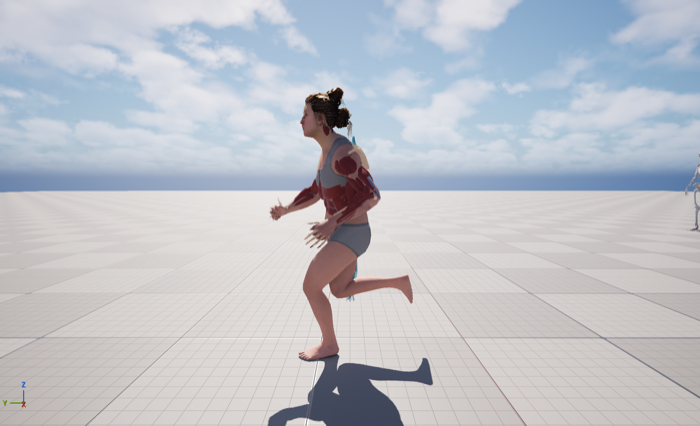
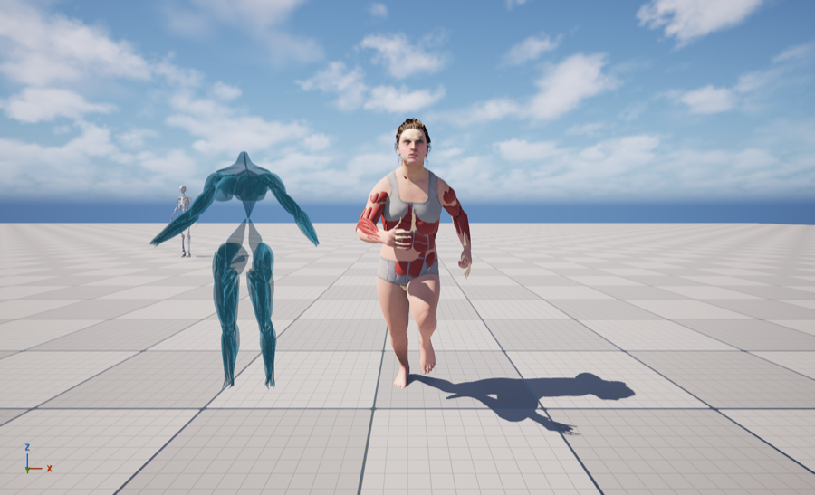

# Abby MetaHuman: Anatomy Layers + Locomotion

Work log and assets for `BP_MH_CH_Abby8` (UE 5.8). Every layer (MetaHuman body, face, hair, muscle mesh, skeleton mesh) now follows the same walk / jog / run, and Abby's locomotion blends smoothly with the speed slider.

| | |
|---|---|
|  |  |

- **Progress:** [TODO.md](TODO.md)
- **Investigation (why the layers were frozen):** [docs/01-investigation.md](docs/01-investigation.md)
- **Animation fixes and enhancement:** [docs/02-animation.md](docs/02-animation.md)

## What changed in the project

| Asset | Change |
|---|---|
| `Plugins/MetaHumanAnatomyLayers/` (**new, portable**) | Muscle and skeleton meshes with MetaHuman bone names (Leader Pose compatible), self-contained materials, Python build/wire tools. [README](project/Plugins/MetaHumanAnatomyLayers/README.md) |
| `BP_MH_CH_Abby8` | `MuscleMesh` and `SkeletonMesh` moved under `Body`, using the plugin meshes (Leader Pose = Body). Body Anim Class = `ABP_Abby_Enhanced` |
| `/Game/Abby_Animation/Enhanced/` (**new**) | `ABP_Abby_Enhanced` (smoothed speed, walk → jog → run blend, foot-synced) and walk / jog / run copies with L/R sync markers |
| `ABP_Abby`, original animations, `RTG_AutoGenerated` | Untouched |

## Repo layout

| Path | What |
|---|---|
| `project/` | Mirror of `.uproject`, `Config/` (Android File Server token redacted), `Source/`, the plugin, and only the `.uasset` files this work created or changed (`tools/tracked_assets.txt`) |
| `scripts/jobs/` | The editor Python jobs that were run, in order (investigation, build, measurements) |
| `tools/` | `launch_editor.sh` (starts the editor with the MCP server and the Python bridge), `claude_bridge.py` / `ue_bridge.py` (file-based editor Python bridge), `sync_from_project.sh` |
| `docs/` | Findings and screenshots |

The full project (about 7 GB of MetaHuman and scan content) stays in Perforce. To use the changed assets elsewhere, copy `project/Content/...` and `project/Plugins/...` over the same paths, with the editor closed.
