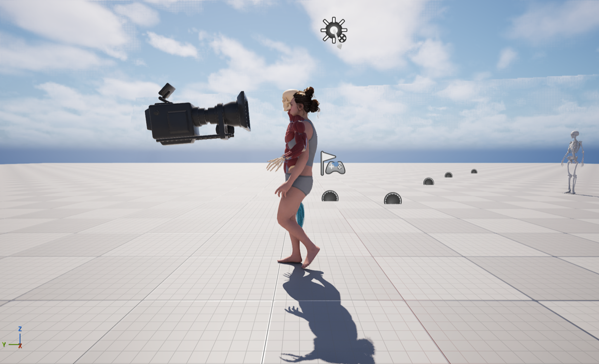
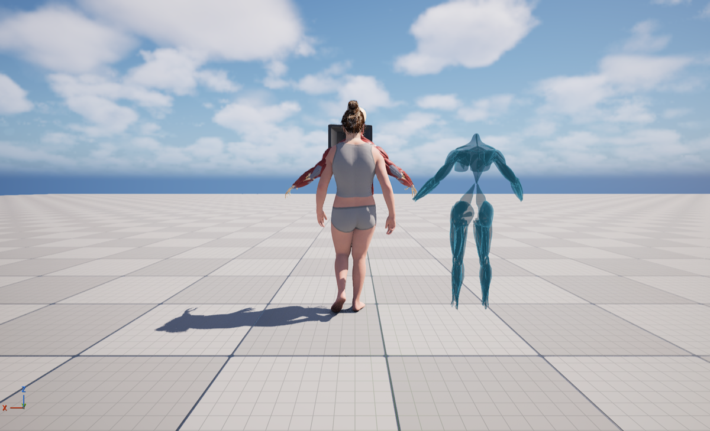

# 01 · Investigation (2026-11-07)

Project: `MetaHumanTest` (UE 5.8), level `/Game/Main`, actor `BP_MH_CH_Abby8` at (420, 80, 0).

## What `BP_MH_CH_Abby8` contains

| Component | Mesh | Skeleton | Animation today |
|---|---|---|---|
| `Body` | `SKM_MH_CH_Abby5_BodyMesh` | MetaHuman body (342 bones) | `ABP_Abby` state machine |
| `Face` (child of Body) | `SKM_MH_CH_Abby5_FaceMesh` | MetaHuman face | follows Body |
| Grooms (hair, brows, lashes…) | — | — | follow Body/Face |
| `MuscleMesh` (child of **Root**) | `SKM_Emil_upperBodyMuscles` (Chaos Flesh example) | `SK_Emil_Muscles` (87 bones) | **none: frozen in A-pose** |
| `SkeletonMesh` (child of **Root**) | `SKM_skeleton_upper_body` (Chaos Flesh example) | `SK_Emil_Muscles` | **none: frozen in A-pose** |

Parent class: C++ `ACPP_AbbyCharacter` (a `Pawn` with a `Speed` float that the speed-slider widget sets, 0–1).

## Why the muscle and skeleton meshes don't run

1. They have no Anim Blueprint and no leader pose, so they never move.
2. They're attached to `Root`, not `Body`, so the construction script's `EnableMasterPose` loop (which only walks Body's children) skips them.
3. Simply turning on leader pose would **not** work: Emil's skeleton shares only 58 bone names with the MetaHuman body. The limbs use anatomical names:

| MetaHuman (Abby) | Emil anatomy |
|---|---|
| `upperarm_l/r` (+ twist) | `humerus_l/r` (+ twist) |
| `lowerarm_l/r` (+ twist) | `ulna_l/r` (+ twist) |
| `thigh_l/r` (+ twist) | `femur_l/r` (+ twist) |
| `calf_l/r` | `tibia_l/r` |
| `foot_l/r` | `ankle_l/r` |

   With leader pose the hands, fingers and feet (same names) would snap to Abby while the humerus, ulna, femur and tibia stayed in A-pose, which tears the arms and legs apart.
4. Emil is a larger, male skeleton: his skull and shoulders sit above and outside Abby's body. The fix has to adopt **Abby's proportions**, not just her rotations.

**Plan:** an IK Retargeter Abby → Emil, plus an anatomy Anim Blueprint using *Retarget Pose From Mesh* (source = Body). Both anatomy meshes get attached to Body.

## Abby's animation setup

- `ABP_Abby` (`/Game/MetaHumans/MH_CH_Abby5/Body/`): state machine Walking ⇄ Jogging ⇄ Running on `Speed`
  - Walk → Jog when `Speed > 0.58`; Jog → Run when `Speed > 0.7`; Run → Jog when `Speed ≤ 0.7`; Jog → Walk when `Speed ≤ 0.5`
  - No blend times or sync groups, so speed changes pop. A leftover `TryGetPawnOwner` node is unconnected.
  - `Speed` is pushed every tick from `BP_MH_CH_Abby8`'s EventTick (cast to `ABP_Abby`, set Speed).
- Animations `AbbyWalking_Anim`, `AbbyJogging`, `AbbyRunning__2_` (`/Game/Abby_Animation/New/`) were produced by `RTG_AutoGenerated`, an auto-generated retargeter from the Mixamo-style `/Game/Animation2/Walking` skeleton to Abby's body, with auto IK rigs `IK_AutoGeneratedSource` and `IK_AutoGeneratedTarget`.

## Other things in the level
- About 180 `SM_SM_*` static-mesh muscle actors at (320, 80, 0) (the translucent blue figure). These are static meshes and can't animate.
