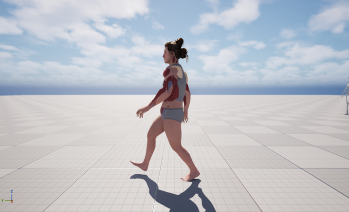
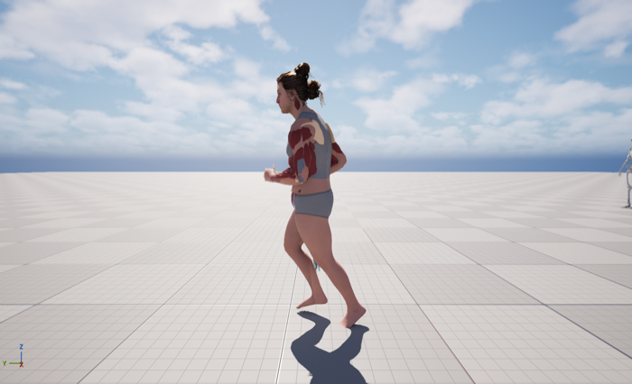
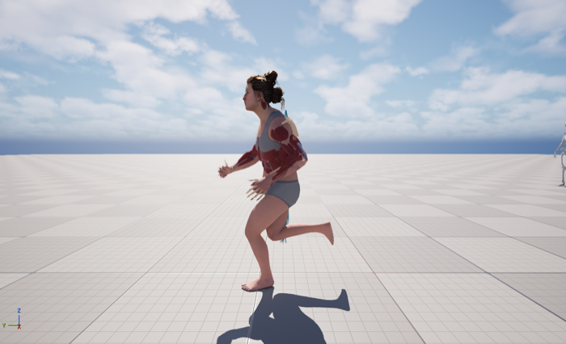
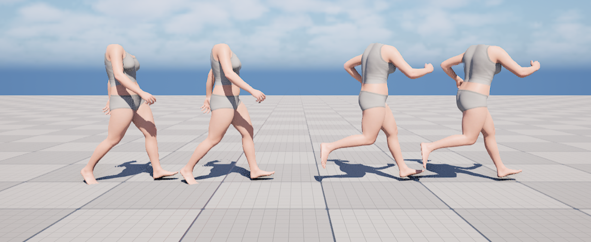
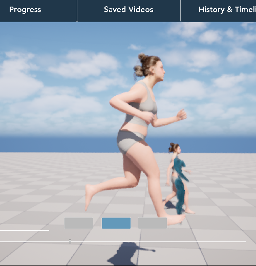

# 02 · Abby's retargeted animations: fix and enhancement (2026-11-07)

## What was measured

Every frame of the Mixamo source and Abby's retargeted walk, jog and run was sampled (`scripts/jobs/16`–`18`).

| | Walk | Jog | Run |
|---|---|---|---|
| Hands, min lateral distance from midline (1 = shoulder): Mixamo → Abby | 1.39 → 1.36 | 0.49 → 0.57 | 1.03 → 1.08 |
| In place? (pelvis drift over a loop) | yes (< 1 cm) | yes (3 cm) | yes (< 1 cm) |
| Loop seam (first vs last frame ≈ one frame step) | seamless | seamless | seamless |
| Toe height min (Abby rest = 1.1 cm) | −1.0 | −1.7 | −1.9 |

**Conclusions**
- The auto-generated retargeter (`RTG_AutoGenerated`) is fundamentally sound. Its Default Pose already aligns Abby's A-pose arms to the Mixamo T-pose (upper arm +53°, elbow −37°), and the arm paths match the source. The "arms crossing" seen in the front view is forward reach in perspective, not a retarget error.
- The only measurable defect: **toes dip 2–3 cm into the floor at push-off**, because the retarget is FK-only.
- Tried: leg IK (`Retarget IK Goals` + `Floor Constraint` + `Run IK Rig` ops). It fixed the toes (−1.9 → +0.1 cm), but the IK goals take Mixamo's foot heights, so the heels sank about 1 cm and the pelvis dropped about 3 cm. Re-running op setup through Python also broke the pelvis in that experimental copy. **Not adopted**; the `/Game/Abby_Animation/Fixed/` experiment is to be deleted.

## The real problem: the Anim Blueprint

`ABP_Abby` hard-switched between Walking, Jogging and Running at 0.5 / 0.58 / 0.7 with no blend time and no foot sync, so moving the speed slider made Abby pop between gaits with her feet out of phase.

## Enhancement: `ABP_Abby_Enhanced` (`/Game/Abby_Animation/Enhanced/`)

- **Speed smoothing**: reads `Speed` (0–1, from the slider) straight off the `CPP_AbbyCharacter` pawn and eases `BlendSpeed` toward it (`FInterpTo`, rate `SpeedSmoothing = 4`), so slider jumps turn into smooth accelerations.
- **Continuous gait blend**: walk → jog → run with two `TwoWayBlend` nodes and alphas `MapRangeClamped(BlendSpeed, 0.45..0.62)` and `(0.62..0.80)`. Walk below 0.45, pure jog at 0.62, pure run from 0.80.
- **Foot-synced blending**: copies `AbbyWalk_Sync`, `AbbyJog_Sync`, `AbbyRun_Sync` carry **L/R sync markers at each foot's mid-stance** (computed from foot motion). All three players are in sync group `Locomotion`, so the feet stay in phase while blending.
- It needs no cast from the character Blueprint, so it works on any pawn derived from `CPP_AbbyCharacter`.

`BP_MH_CH_Abby8 → Body → Anim Class = ABP_Abby_Enhanced`. The muscle and skeleton layers follow through Leader Pose.

| Walk (0.25) | Jog (0.62) | Run (0.95) |
|---|---|---|
|  |  |  |

Notes
- A 1D Blend Space (`BS_Abby_Locomotion`) was tried first. Its samples saved correctly from Python, but its runtime blend data was never rebuilt, so it output the rest pose. The explicit blend graph is used instead; the blend space will be removed.
- The original `ABP_Abby` and the original animations are untouched.

## Follow-up: hunched back and dropped shoulders fixed (jobs 41–48)

Feedback: walking and running made Abby's back bend and her shoulders drop.

**Measured** (job 41/43, every frame, as change from each skeleton's own rest pose):

| Upper-back rounding vs rest | Walk | Jog | Run |
|---|---|---|---|
| Mixamo source | +1.8° | +6.3° | +2.5° |
| Abby before | **+17.4°** | **+21.5°** | **+18.0°** |
| Abby now (`Upright`) | +5.0° | +11.1° | +11.5° |

| Shoulder (clavicle) drop vs rest | Walk | Jog | Run |
|---|---|---|---|
| Mixamo source | −1.6° | −14.5° | −10.4° |
| Abby before | −2.4° | −17.0° | −13.8° |
| Abby now | +1.4° | −13.4° | −10.3° |

**Cause.** `RTG_AutoGenerated`'s target retarget pose had *auto-aligned* Abby's torso to Mixamo's straight T-pose spine:

| Bone | Offset |
|---|---|
| pelvis | −6.8° |
| spine_01 | −14.7° |
| spine_02 | +7.3° |
| spine_03 | +9.5° |
| spine_04 | +8.5° |

That's about 25° of forward rounding in the upper back. Every retargeted frame inherits it on top of the animation's own lean, so she hunched and her shoulders rolled down. The Mixamo jog and run also drop the shoulders by themselves (10–15°); the retarget added about 3° more.

**Fix** (new retargeter; the original is untouched):

- `/Game/Abby_Animation/Posture/RTG_Mixamo_To_Abby_Posture`, retarget pose **`Upright`**:
  - **Pelvis:** keeps its −6.8°, so the legs are identical to before (same stride, same toe height). spine_01 = +6.8° cancels it for the torso.
  - **Upper spine:** spine_02–04 = 0, so Abby keeps her natural upright S-curve.
  - **Clavicles:** pitch +4° (+5° pitch measured as +4.6° of lift; job 46), which cancels the extra shoulder drop.
  - **Arms:** keep their A → T alignment.
- `Abby_Walking_Anim_Upright`, `Abby_Jogging_Upright`, `Abby_Running__2__Upright` (same frames, so the L/R foot-sync markers were copied over 1:1). `ABP_Abby_Timeline` evaluates these now.
- Two variants were compared: removing *all* torso offsets also straightened the back, but changed the stride by up to 18%. Keeping the pelvis offset was chosen.

Before → after, walk and run (body mesh only, same source frame):

Abby running in PIE with the new clips:

