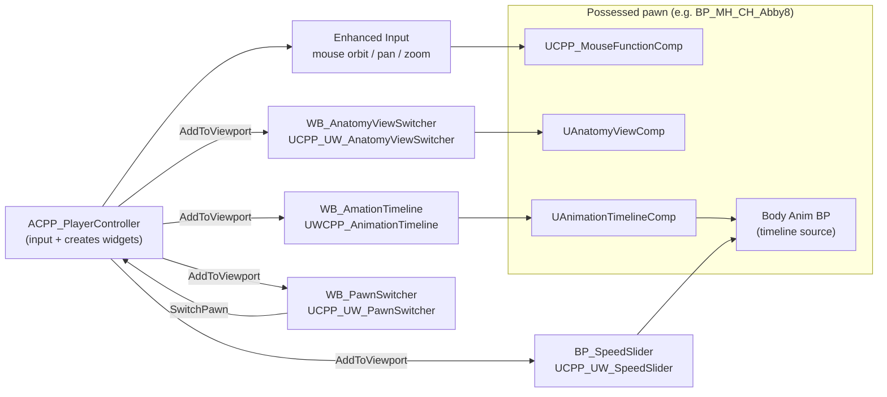
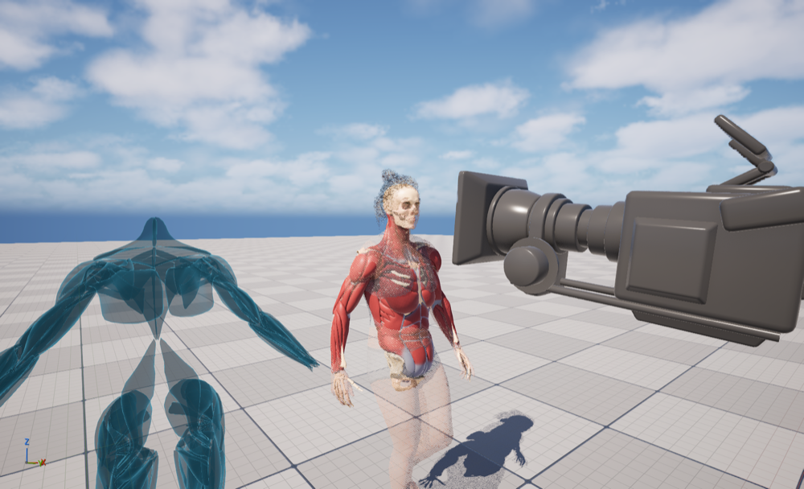
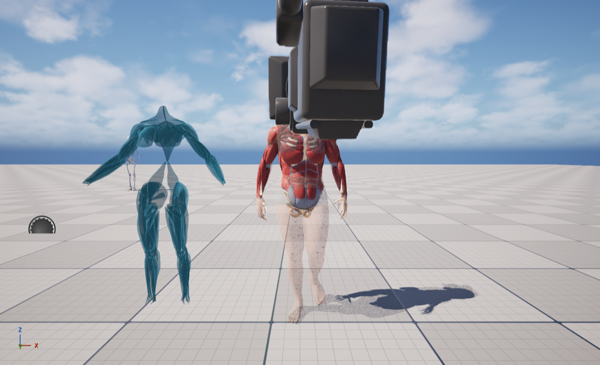

# Part 4: UI sliders (anatomy view + animation timeline)

Goal: make the two sliders in the viewer UI work:

- **Anatomy slider:** goes *through* the body like an anatomy app. Skin fades and reveals the muscles; the muscles then fade and reveal the skeleton.
- **Animation time slider:** play, pause, reverse and scrub the animation.

These follow the project's architecture (below), so switching the possessed pawn changes what the same buttons do.

Progress lives in [TODO.md § 4](../TODO.md#4-ui-sliders-anatomy-view--animation-timeline).

## The architecture this work follows

The PlayerController owns input and puts the widgets on screen. The widgets only translate clicks and drags. The actual work is done by **components on the pawn**. If the controller possesses a different pawn, the same buttons drive that pawn's components, or are disabled if the pawn doesn't have one.

## Step 1: what was there (inspection, jobs 30–33)

| Piece | State before |
|---|---|
| `BP_GameMode` | Default pawn `BP_MH_CH_Abby8`, controller `BP_PlayerController` |
| `BP_PlayerController` (`ACPP_PlayerController`) | Creates `WB_AmationTimeline`, `WB_AnatomyViewSwitcher`, `WB_PawnSwitcher`. The speed slider is commented out. `BeginPlay` never called `Super::BeginPlay()`. Looked for the placeholder manager with `GetActorOfClass(APlayerCameraManager)`, so it was never found |
| `WB_AmationTimeline` | `Slider_Time` plus Play / Pause / Reverse buttons → `UAnimationTimelineComp` on the pawn |
| `UAnimationTimelineComp` (on Abby8) | Built for a **single-node** clip (`AnimationSequence = Jogging_InTime`). Abby's Body runs an Anim Blueprint, so `SingleNodeInstance` was null and **nothing moved** |
| `WB_AnatomyViewSwitcher` | Vertical slider (top = 1 = full MetaHuman) and three buttons: MetaHuman / Muscle / Skeleton. All of the logic lived *in the widget*. It needed component tags that Abby8 doesn't have (null-pointer crash). It also moved `SkeletonMesh`, which now breaks leader pose, and only the MetaHuman button was bound |
| `WB_PawnSwitcher` | Up / Down buttons, handlers empty |
| Materials | MetaHuman skin, eyes, teeth and hair materials are **Masked** with a built-in `Fade` scalar (1 = visible, 0 = gone, dithered). The anatomy muscle and bone materials were Opaque with no fade |

The `Fade` test on the placed Abby (skin at 0.35, muscles and skeleton visible) shows the anatomy-app look works with the stock MetaHuman materials:

|  |  |
|---|---|

(The camera mesh in the shots is the editor-only gizmo for the pawn's CineCamera.)

## Step 2: anatomy materials get the same `Fade` (job 34)

`M_Anatomy_Muscle` and `M_Anatomy_BlockColour` (the bone material) in the plugin are now **Masked**, with `Fade` (default 1) → `DitherTemporalAA` → Opacity Mask. That's the same convention as the MetaHuman materials, so one parameter fades every layer. `M_Anatomy_Hidden` was also added: an always-invisible material for slots with no fade parameter (for example the MetaHuman eye occlusion shell).

<!-- next steps are appended below as they are done -->
