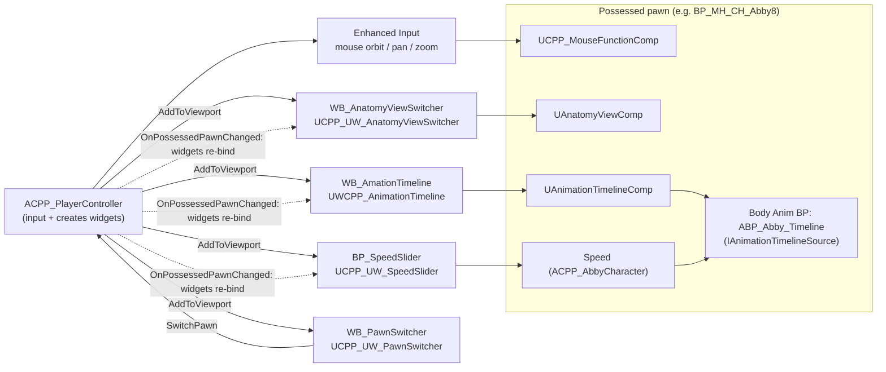
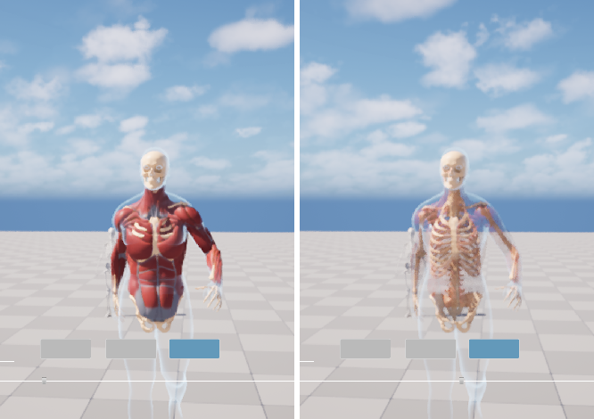
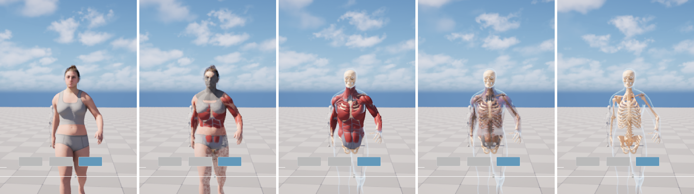
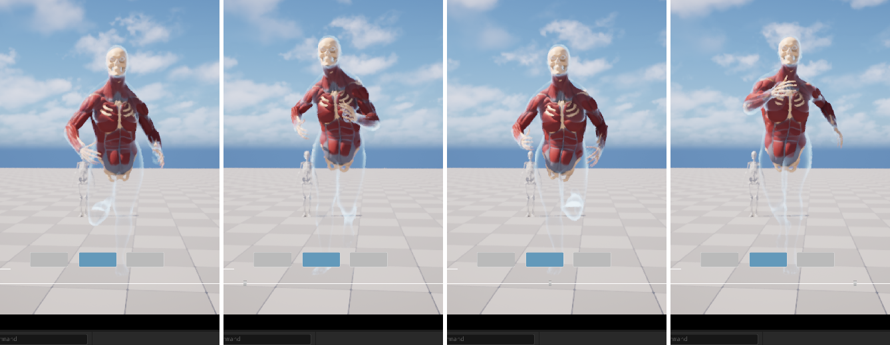
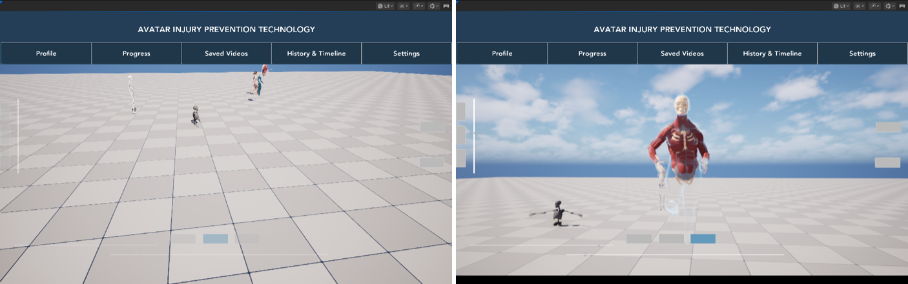

# Part 4: UI sliders (anatomy view + animation timeline)

Goal: make the two sliders in the viewer UI work:

- **Anatomy slider:** goes *through* the body like an anatomy app. Skin fades and reveals the muscles; the muscles then fade and reveal the skeleton.
- **Animation time slider:** play, pause, reverse and scrub the animation.

These follow the project's architecture (below), so switching the possessed pawn changes what the same buttons do.

Progress lives in [TODO.md § 4](../TODO.md#4-ui-sliders-anatomy-view--animation-timeline).

## The architecture this work follows

The PlayerController owns input and puts the widgets on screen. The widgets only translate clicks and drags. The actual work is done by **components on the pawn**. If the controller possesses a different pawn, the same buttons drive that pawn's components, or are disabled if the pawn doesn't have one.

## Step 1: what was there (inspection, jobs 30–33)

| Piece | State before |
|---|---|
| `BP_GameMode` | Default pawn `BP_MH_CH_Abby8`, controller `BP_PlayerController` |
| `BP_PlayerController` (`ACPP_PlayerController`) | Creates `WB_AmationTimeline`, `WB_AnatomyViewSwitcher`, `WB_PawnSwitcher`. The speed slider is commented out. `BeginPlay` never called `Super::BeginPlay()`. Looked for the placeholder manager with `GetActorOfClass(APlayerCameraManager)`, so it was never found |
| `WB_AmationTimeline` | `Slider_Time` plus Play / Pause / Reverse buttons → `UAnimationTimelineComp` on the pawn |
| `UAnimationTimelineComp` (on Abby8) | Built for a **single-node** clip (`AnimationSequence = Jogging_InTime`). Abby's Body runs an Anim Blueprint, so `SingleNodeInstance` was null and **nothing moved** |
| `WB_AnatomyViewSwitcher` | Vertical slider (top = 1 = full MetaHuman) and three buttons: MetaHuman / Muscle / Skeleton. All of the logic lived *in the widget*. It needed component tags that Abby8 doesn't have (null-pointer crash). It also moved `SkeletonMesh`, which now breaks leader pose, and only the MetaHuman button was bound |
| `WB_PawnSwitcher` | Up / Down buttons, handlers empty |
| Materials | MetaHuman skin, eyes, teeth and hair materials are **Masked** with a built-in `Fade` scalar (1 = visible, 0 = gone, dithered). The anatomy muscle and bone materials were Opaque with no fade |

The `Fade` test on the placed Abby (skin at 0.35, muscles and skeleton visible) shows the anatomy-app look works with the stock MetaHuman materials:

|  |  |
|---|---|

(The camera mesh in the shots is the editor-only gizmo for the pawn's CineCamera.)

## Step 2: plugin materials (jobs 34, 38, 40)

All of these use the MetaHuman convention: a scalar `Fade`, where 1 = visible and 0 = gone, drives `DitherTemporalAA` → Opacity Mask.

| Material (plugin) | Purpose |
|---|---|
| `M_Anatomy_MuscleFade` (**new**) | Muscle red plus tendon mask, Masked, with `Fade`. The Muscles layer switches to it **only while it is fading**; at full opacity the detailed original `M_Anatomy_Muscle` is shown |
| `M_Anatomy_XRay` (**new**) | Translucent, unlit fresnel shell. Once the skin is below 15%, the Skin layer switches to it, so the body outline (including the legs) stays visible around the muscles and bones |
| `M_Anatomy_Hidden` (**new**) | Always invisible. Used for slots that have no fade parameter (e.g. the MetaHuman eye occlusion shell) while their layer fades |
| `M_Anatomy_Muscle`, `M_Anatomy_BlockColour` | Unchanged (Opaque, as copied from the Emil example) |

**Two problems on the way, for the record:**

- **The Emil-derived muscle and bone materials never clip.** I first added `Fade` → dither → Opacity Mask to those materials. The muscles stayed fully opaque even with `Fade = -5`, and even with a constant 0 wired into Opacity Mask on a fresh duplicate. The usual suspects were all ruled out: stale shaders, Material Attributes, Substrate (off), deformer usage flags, Nanite (off). A material built from scratch clips fine on the same mesh, which is why the fade now lives in `M_Anatomy_MuscleFade` (proof below: left, the old material at Fade 0.5; right, `M_Anatomy_MuscleFade` at 0.4).
- **Saving while PIE is running silently does nothing.** `save_loaded_asset` returns False. The first version of the clip fix and the x-ray material were lost that way; the job scripts now refuse to run during PIE.

The dither: `DitherTemporalAA` outputs `Fade + noise − 0.5`, so with the clip value at **0.5**, coverage equals `Fade` (the default 0.333 leaves about 17% visible at `Fade = 0`).

## Step 3: C++ (the components do the work)

**Plugin module `MetaHumanAnatomyLayers`** (new runtime module, so the component travels with the meshes and materials):

- **`UAnatomyViewComp` ("Anatomy View")**, on the pawn.
  - **Layers** are data, listed outside → in: `Skin` (every visible mesh nothing else claims: body, face, hair, clothes), `Muscles` (`MuscleMesh` / tag `MusclePart`), `Skeleton` (`SkeletonMesh` / tag `SkeletonPart`). A different pawn can define its own layers (e.g. a robot: shell → frame → electronics) and the same slider peels it.
  - **API:**
    - `SetRevealDepth(0..1)`: 0 = whole character, 1 = innermost layer only.
    - `ShowLayer(i)`: animates to layer `i`.
    - `GetRevealDepth()`.
    - `OnRevealDepthChanged`: an event the slider listens to, so it follows the button animation.
  - **Per layer:**
    - An optional `FadeMaterial`: Muscles → `M_Anatomy_MuscleFade`.
    - An optional `GhostMaterial` with `GhostBelowOpacity`: Skin → `M_Anatomy_XRay` at 15%.
  - **Slots that fade themselves:** MetaHuman skin, eyes, teeth and hair use their own `Fade` through dynamic material instances. Translucent cards use `Opacity`; anything else uses `M_Anatomy_Hidden` while fading. Original materials come back at full opacity.
  - **Hidden meshes:** fully faded meshes are hidden (cheaper), but a hidden `Body` keeps ticking its pose (`AlwaysTickPoseAndRefreshBones`), so the Leader Pose followers keep animating. Hair strands hide below 50%, because dithered strands look noisy.

**Game module `MetaHumanTest`:**

| Class | What it does |
|---|---|
| `IAnimationTimelineSource` (new) | Interface: an anim instance whose time can be set from outside (`SetTimelinePosition`, `GetTimelineCycleLength`) |
| `UAnimationTimelineComp` (rewritten) | Owns the clock: `PlayForward`, `PlayReverse`, `Pause`, `TogglePlayPause`, `SetNormalizedTime`, `BeginScrub` / `EndScrub`, `StepSeconds`, looping, `PlaySpeed`, `OnPlayStateChanged`. **Drive modes:** an Anim BP through the interface (Abby), a single clip (`AnimationSequence`, e.g. `Jogging_InTime`: set `DriveMode = SingleClip`), or rate-only pause/play for any other Anim BP. It ticks before the mesh (tick prerequisite), so the pose is never a frame late |
| `UCPP_LocomotionAnimInstance` (new) | Parent of `ABP_Abby_Timeline`. Walk / jog / run evaluated at an explicit **gait-cycle phase**: 0 = left-foot contact (sync marker `L`), 1 = the next left-foot contact. The jog clip holds three strides, so the phase steps through them as it wraps, forward and backward. Speed blend: walk→jog 0.45–0.62, jog→run 0.62–0.80, smoothed. Without a timeline it just plays forward |
| `UWCPP_AnimationTimeline` | Play / Pause / Reverse / slider → timeline component. The slider shows the clock; dragging scrubs (playback holds while you drag). The active button is tinted |
| `UCPP_UW_AnatomyViewSwitcher` | Slider → `SetRevealDepth`. MetaHuman / Muscle / Skeleton buttons → `ShowLayer(0/1/2)` (animated). Follows `OnRevealDepthChanged` |
| `UCPP_UW_SpeedSlider` | Back on screen; null-safe (it used to crash on a non-Abby pawn) |
| `UCPP_UW_PawnSwitcher` | Up / Down → `ACPP_PlayerController::SwitchPawn(±1)` |
| `ACPP_PlayerController` | Now calls `Super::BeginPlay()`, which was missing, so the BP's own BeginPlay never ran. Finds the placeholder manager by its real class (it was searching for `APlayerCameraManager`). `SwitchPawn`: spawns each `SwitchablePawnClasses` entry once at its placeholder and possesses it |
| Cleanup | Removed `UCPP_WBP_SpeedSlider`: it derived from the editor-only `UWidgetBlueprint` (`UMGEditor`), which would break a packaged build, and no asset used it. Removed stray includes (`gsl`, `SWarningOrErrorBox`, `TaskSyncManager`). Mouse component: null-safe, with a pitch clamp (−80°…80°) so the orbit can't flip |

Every widget:
- binds to the controller's `OnPossessedPawnChanged`;
- re-finds its component on the new pawn;
- **greys itself out** if that pawn doesn't have one;
- re-finds the component if it is ever destroyed (safety net).

## Step 4: assets (jobs 35, 36, 40 + MCP)

| Asset | Change |
|---|---|
| `ABP_Abby_Timeline` (new, `/Game/Abby_Animation/Enhanced`) | Parent `UCPP_LocomotionAnimInstance`. AnimGraph: `Evaluate'AbbyWalk_Sync'` / `Jog` / `Run` (Explicit Time = `WalkTime` / `JogTime` / `RunTime`) → Two-Way Blend (`WalkJogAlpha`) → Two-Way Blend (`JogRunAlpha`) → Output Pose |
| `BP_MH_CH_Abby8` | Body Anim Class = `ABP_Abby_Timeline`. New `AnatomyView` component (added by the plugin's `build.wire_blueprint`). Removed the Event Tick cast to `ABP_Abby`, which failed every frame; the auto-rotate stays |
| `BP_PlayerController` | `SwitchablePawnClasses = [BP_MH_CH_Abby8, BP_SkeletonModel]` |
| `BP_SpeedSlider` | `MaxSpeed` 100 → 1 (the Anim BP expects 0..1) |
| `WB_AmationTimeline`, `WB_AnatomyViewSwitcher`, `WB_PawnSwitcher` | Recompiled against the new C++. Layout untouched |

## Step 5: verified in PIE

The anatomy slider at reveal depth 0, 0.2, 0.5 (Muscle button, animated), 0.75 and 1.0 (Skeleton button):

The timeline paused and scrubbed through one running gait cycle (phase 0, 0.25, 0.5, 0.75; muscle view). Phase 0 lands on the left-foot-contact marker of every clip (walk 0.499 s, jog 2.015 s, run 0.324 s). The Pause button is the highlighted one:

Pawn switching: Up possesses `BP_SkeletonModel`. It has no anatomy, timeline or speed components, so those widgets grey out. Down returns to Abby, whose state (muscle view, playing) is still there:

`tools/pie.sh` drives the running PIE session from a terminal: `status`, `depth:0.3`, `layer:2`, `play`, `pause`, `reverse`, `time:0.5`, `speed:0.9`, `switch:1`.

**Test-harness pitfall.** `set_editor_property()` on a PIE actor's component fires PostEditChange. That re-runs the Blueprint construction script and **re-creates every component**, so the widgets were left holding dead pointers. Pass `unreal.PropertyAccessChangeNotifyMode.NEVER`. The widgets now recover from this anyway.

## How to use / extend

- **Another MetaHuman:** run `build.wire_blueprint("/Game/.../BP_X")` (from `anatomy_layers`). It adds the anatomy meshes and the AnatomyView component. Then add an `AnimationTimelineComp` and give Body an Anim BP derived from `UCPP_LocomotionAnimInstance`, or set the timeline to `SingleClip` with any clip.
- **A different pawn with different behaviour:** give it its own components. For example, an `AnatomyViewComp` with other `Layers`, or no timeline at all. The same widgets drive whatever the possessed pawn has.
- **Mocap clip on the timeline:** on the pawn's `AnimationTimelineComp`, set `DriveMode = SingleClip` and `AnimationSequence = Jogging_InTime`.
