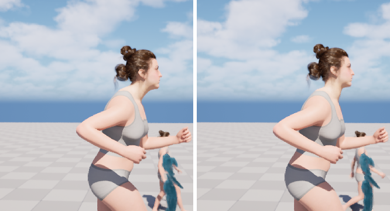
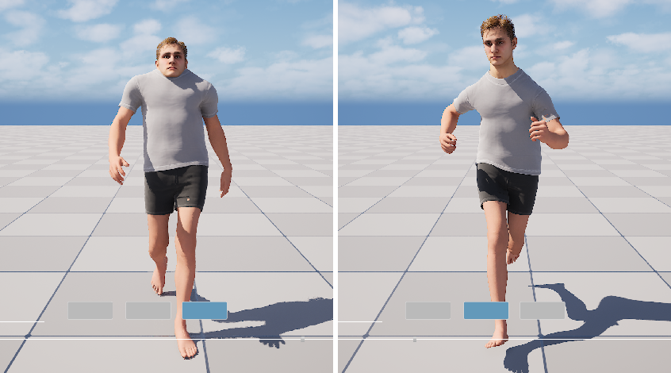
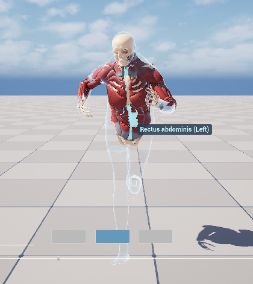
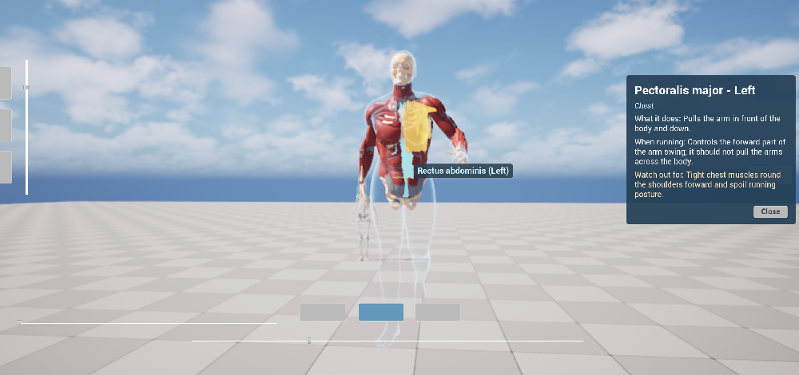
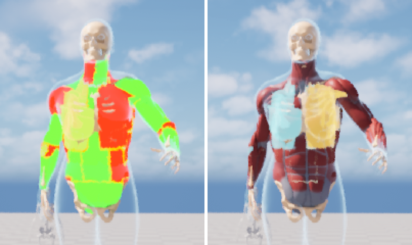

# Part 4: running neck, a second character (Beau), muscle hover and click info

Feedback after Part 3:

> it is better, the neck is also bending forward when she is running, fix that too. Also there is another character in the MadisonTesting folder: add that guy as the second person so we can switch between them. Also for the muscles, make a basic pop up when the player clicks on some of them that tells about that muscle, and when the player hovers over them while the slider is about halfway (in the muscle section), highlight the muscle and show its name in a tiny modal.

Everything still follows the project architecture:

- The **PlayerController** reads the mouse and adds the widgets.
- The **components on the pawn** do the work (`AnatomyViewComp`, `AnatomyPickerComp`, `AnimationTimelineComp`).
- The **widgets** only display what those components report.

Switching to Beau re-binds every widget to Beau's own components.

| # | Done | Jobs |
|---|---|---|
| 1 | Neck straightened at jog and run (runtime, per character) | 49–53, 60, 64 |
| 2 | Beau assembled from his MetaHuman Character, switchable with Abby (Up / Down) | 54, 58, 59, 63 |
| 3 | Muscle hover highlight with a name tooltip, and click for an info popup | 55–57, 61, 62 |

---

## 1. Neck bent forward while running

### Measuring it (jobs 49, 52, 53)

Metric: the angle of the line *neck_01 → head* from vertical in the walking direction (+ = head forward).

In the `*_Upright` clips Abby's head sat a few degrees further forward than the Mixamo source at walk. At a run the gap grew to **26–36°** forward of vertical. On screen that reads as the neck poking forward (left image below).

### What didn't work: retarget-pose neck offsets (jobs 50, 51)

Rotating `neck_01` / `neck_02` in the `Upright` retarget pose mostly **tilted the face up** (about 5°) instead of moving the neck back. The retargeter's Neck chain is FK *interpolated*, so the offsets get spread and re-solved. The `_Posture` test clips were deleted.

### What works: a runtime correction in the Anim Instance

`UCPP_LocomotionAnimInstance` has two new settings, `NeckUprightAtJog` and `NeckUprightAtRun` (degrees). It blends them by the gait weights:

```cpp
const float NeckDegrees = JogWeight * NeckUprightAtJog + RunWeight * NeckUprightAtRun;
NeckCorrection = FRotator(0.f, -NeckDegrees, 0.f);   // neck_01: straighten
HeadCorrection = FRotator(0.f,  NeckDegrees, 0.f);   // head: turn back so the gaze stays level
```

The AnimGraph applies them after the walk / jog / run blend:

> Local To Component → Transform (Modify) Bone `neck_01` (rotation additive, bone space, `NeckCorrection`) → Transform (Modify) Bone `head` (`HeadCorrection`) → Component To Local → Output

A few things follow from this:

- Walking is unchanged (both weights are 0).
- The correction ramps in smoothly with speed.
- It works on any clip.
- Each character gets its own amount from its Anim BP defaults.

Measured in PIE at run speed. Set the timeline time and read the pose one frame later; reading in the same call returns the previous frame's pose:

| Head forward of vertical | phase 0.1 | 0.3 | 0.55 | 0.8 |
|---|---|---|---|---|
| Abby, no correction | 36.0° | 32.3° | 27.7° | 25.9° |
| **Abby, 17° (`ABP_Abby_Timeline`: run 17, jog 14)** | **19.1°** | **15.5°** | **10.7°** | **9.7°** |
| Beau, no correction | 11.1° | 15.0° | 13.7° | 8.9° |
| Beau, 17° (too much: leans back) | −5.8° | −1.5° | −3.3° | −6.8° |
| **Beau, 8° (`ABP_Beau_Timeline`: run 8, jog 7)** | ≈ 3° | ≈ 7° | ≈ 6° | ≈ 1° |

Beau's row at 8° is computed from the two rows above it (the correction shifts the angle almost exactly degree for degree).



Abby running, side view, same frame. Left: no correction. Right: 17°.

---

## 2. Beau as the second person

### Assembling him (job 54)

`/Game/MadisonTesting/BeauMHCharacter/MHC_Beau` is a **MetaHuman Character** asset: the editable source, not a playable Blueprint. Job 54 assembles it with the MetaHuman Character editor subsystem. That writes `Unpacked/Beau/` (`BP_Beau`, body, face, outfit, groom):

```python
mhs = unreal.get_editor_subsystem(unreal.MetaHumanCharacterEditorSubsystem)
mhs.try_add_object_to_edit(mhc)
assert mhs.can_build_meta_human(mhc)
mhs.build_meta_human(mhc, unreal.MetaHumanCharacterEditorBuildParameters())
```

### His pawn (job 58)

`BP_Beau_Pawn` is a copy of the assembled `BP_Beau`, so re-assembling him doesn't overwrite it. It's set up like Abby:

- Parent class `ACPP_AbbyCharacter` (the pawn with `Speed`).
- `SpringArm` and `Camera`, the mouse and timeline components.
- `MuscleMesh` and `SkeletonMesh` under `Body`, plus `AnatomyView` and `AnatomyPicker`. The plugin's `build.wire_blueprint` adds all four.
- Walk / jog / run clips retargeted onto his body with the same `RTG_Mixamo_To_Abby_Posture` / `Upright` pose. The foot-sync markers are copied over.
- `ABP_Beau_Timeline`: same parent class and AnimGraph as Abby's (explicit-phase gait blend and the neck nodes).

Job 59 adds him to `BP_PlayerController.SwitchablePawnClasses`: **Abby → Beau → skeleton model** (Up / Down).

### His head sat on his shoulders (job 63)

The first PIE test showed no neck at all: `neck_01` and `head` were at the **same position**. In his retargeted clips every bone came out 15–20% short. Worst were `neck_02` and `head`, at −0.4 and −0.6 cm where his skeleton has 5.7 and 5.9 cm. The retarget had applied bone lengths that weren't his. (Abby's clips are fine.)

Job 63 bakes his own reference bone lengths into his three clips. For every bone track except `root` and `pelvis`:

- position = Beau's ref-pose local translation;
- rotation and scale stay as animated.

This is what "Skeleton" translation retargeting would do. It's applied to his clips only, because the skeleton asset (`metahuman_base_skel`) is shared with Abby. In PIE his bone lengths now match his mesh exactly:

| | neck_01 → neck_02 | neck_02 → head | shin | forearm |
|---|---|---|---|---|
| PIE | 5.68 | 5.85 | 42.96 | 29.30 |



Left: before job 63 (walk; the head sits on the shoulders). Right: after (run, neck correction 8°).

Everything else carries over, because it lives in components on his pawn: the anatomy slider, timeline, speed, picker and tooltip.



Beau in muscle view, running, with a hover tooltip. The anatomy meshes are the generic Emil upper body driven by his bones, so they're slimmer than his build. That's the known limit of one shared anatomy mesh.

---

## 3. Muscle hover highlight, name tooltip and click popup

### Data: which vertex belongs to which muscle (plugin `Tools/muscle_atlas/`)

The Emil muscle mesh has no per-muscle sections, so the muscles are labelled offline from the exported FBX:

1. **`label_muscles.py`** gives every vertex one of **17 major muscles per side (34 IDs)**:
   - trapezius, deltoid, pectoralis major, biceps, triceps, forearm, hand, latissimus dorsi, erector spinae, rectus abdominis, external oblique, serratus anterior, sternocleidomastoid, jaw, gluteus maximus, gluteus medius, hip flexors.

   It uses the vertex's dominant bone and its position relative to the skeleton, then a 60% majority vote per connected mesh piece and three neighbour-smoothing passes. It also writes `muscle_labels.json` and front / back preview images.
2. **`write_ids.py`** writes each vertex's ID into the FBX vertex colour (red channel).
3. **Job 55** re-imports `SKM_Anatomy_Muscles_UpperBody` from that FBX, keeping its skeleton and materials. It also turns each muscle's sample points into **offsets relative to their bone** (5,192 points), so they can be placed on the animated bones at runtime.
4. **Job 56** builds the data asset `DA_MuscleAtlas_UpperBody` (`UMuscleAtlas`). It holds the 34 muscles with their sample points plus the text from `muscle_info.json`: name, side, region, function, role in running, and what to watch out for.

### Runtime: `UAnatomyPickerComp` (plugin, on the pawn)

- `UpdateHover(RayOrigin, RayDirection)` is called by the controller every tick. It places every sample point on its bone (`GetBoneTransform`, cached per bone). The front-most muscle whose points pass within `PickRadius` (3.5 cm) of the ray wins. No physics or collision is needed, so it follows the animation exactly.
- **Only while the muscles are what you see:** the Muscles layer must be at least `MinLayerOpacity` (0.5) and the skin must already be x-ray. With the slider at the skin end or deep in the skeleton, nothing highlights.
- `SelectHovered()`, `ClearSelection()`, `GetMuscleInfo(Id)`; events `OnHoverChanged` / `OnSelectionChanged`.
- **Highlight:** a copy of the muscle mesh (`MuscleHighlight`) follows the same leader pose with `M_Anatomy_MuscleHighlight`. That translucent, unlit material lights only the vertices whose ID equals `HoverId` (cyan) or `SelectedId` (orange). The copy is visible only while something is hovered or selected.

The controller (`ACPP_PlayerController::UpdateMusclePicking`) feeds it:

- the mouse ray (`DeprojectMousePositionToWorld`), except while the right mouse button orbits;
- a left **click**, meaning press and release within 6 px (`ClickMaxDragPixels`). A longer left drag still pans the camera.

The widget `WB_MuscleInfo` (C++ parent `UCPP_UW_MuscleInfo`, added by the controller via `MuscleInfoWidgetClass`) listens to the possessed pawn's picker:

- **Hover:** a small dark tooltip `Name (Side)` that follows the mouse.
- **Click:** a panel on the right with the muscle's name and side, its region, and three sections: "What it does", "When running" and "Watch out for". **Close** clears the selection.



End to end in PIE: the cursor over Abby's left abs highlights *Rectus abdominis (Left)* in cyan, with its name next to the cursor. The left pectoralis is selected (orange) and its info panel is open.

### Two bugs on the way to a visible highlight

**1. An Overlay Material doesn't render on Leader Pose followers.** It worked on `Body` but not on `MuscleMesh`. That's why the highlight is a separate copy component instead of an overlay.

**2. The glow was invisible, then on the wrong muscle.** Three things stacked up. Each was found with a debug material on the mesh (left image below):

- The material's `VertexColor` is the stored byte / 255, with **no sRGB conversion**. My earlier assumption (and its sRGB-encoded IDs) was wrong.
- The FBX importer **truncates** float × 255. Written as `id / 255`, float error turned 23 into 22.99999, stored as 22, so about half the IDs were one too low. That's why selecting the *left* pectoralis (23) lit the *right* one (24 stored as 23). Now `write_ids.py` writes `(id + 0.5) / 255`. Job 62 reads the imported mesh back (GeometryScript) and checks every vertex against its label: 88,175 of 90,565 match exactly. The rest are seam vertices that share a position with a neighbouring muscle, so position matching can't tell them apart; none are off by one.
- The highlight copy sits exactly on the opaque muscles, so with depth testing it z-fought and showed only as specks. `M_Anatomy_MuscleHighlight` now has **Disable Depth Test** on.



Left: odd IDs (left-side muscles) green, even IDs red, before the fix. The colours don't split cleanly left / right. Right: after the fix, the selected left pectoralis is orange and the hovered right pectoralis is cyan.

### Try it

1. Play.
2. Click the **Muscles** button, or drag the anatomy slider to about the middle.
3. Move the mouse over a muscle: it lights up cyan and its name appears.
4. Click it: it turns orange and the info panel opens. **Close** or clicking empty space clears it.
5. Use the pawn switcher's Up / Down to swap between Abby and Beau.

From a terminal, while PIE runs (`tools/pie.sh`):

```sh
tools/pie.sh depth:0.2      # muscle view
tools/pie.sh switch:1       # next pawn (Beau)
sed 's/__KEY__/biceps_l/' scripts/jobs/61_pie_pick_test.py > /tmp/p.py && python3 -I tools/ue_bridge.py /tmp/p.py   # hover + select by script
```

## Files

| Where | What |
|---|---|
| Plugin `AnatomyPickerComp.h/.cpp`, `MuscleAtlas.h` (new) | Picker component and atlas data asset types |
| Plugin `Content/Anatomy/Data/DA_MuscleAtlas_UpperBody` (new) | 34 muscles: info text and 5,192 bone-relative sample points |
| Plugin `Content/Anatomy/Materials/M_Anatomy_MuscleHighlight` (new) | Hover / selection glow keyed by vertex-colour ID (depth test off) |
| Plugin `SKM_Anatomy_Muscles_UpperBody` | Re-imported with muscle IDs in the vertex colours |
| Plugin `Tools/muscle_atlas/` (new) | `fbxmesh.py`, `label_muscles.py`, `write_ids.py`, `muscle_info.json`, `muscle_atlas_samples.json` |
| Plugin `build.py` | `create_highlight_material`; `wire_blueprint` also adds `AnatomyPicker` |
| `Source/.../CPP_LocomotionAnimInstance` | `NeckUprightAtJog` / `NeckUprightAtRun` → `NeckCorrection` / `HeadCorrection` |
| `Source/.../CPP_UW_MuscleInfo` (new) | Tooltip and popup widget base class |
| `Source/.../CPP_PlayerController` | `MuscleInfoWidgetClass`, `UpdateMusclePicking` (hover ray, click vs drag) |
| `ABP_Abby_Timeline` | Neck / head Modify Bone nodes; run 17, jog 14 |
| `BP_MH_CH_Abby8` | `AnatomyPicker` component |
| `BP_PlayerController` | `MuscleInfoWidgetClass = WB_MuscleInfo`; pawns Abby8 → Beau → SkeletonModel |
| `/Game/Widget/WB_MuscleInfo` (new) | Tooltip and popup layout |
| `/Game/MadisonTesting/BeauMHCharacter/BP_Beau_Pawn` (new) | Beau's playable pawn |
| `/Game/MadisonTesting/BeauMHCharacter/Animation/` (new) | `ABP_Beau_Timeline` (run 8, jog 7) and his walk / jog / run clips (bone lengths fixed) |

`Unpacked/Beau/` (about 350 MB of assembled MetaHuman content) isn't mirrored here. Re-create it from `MHC_Beau` with job 54.
